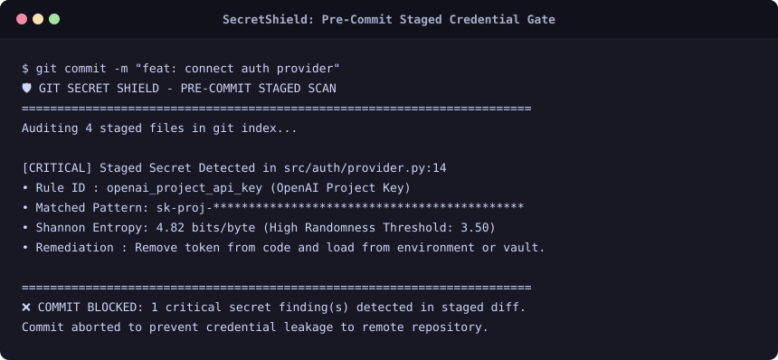
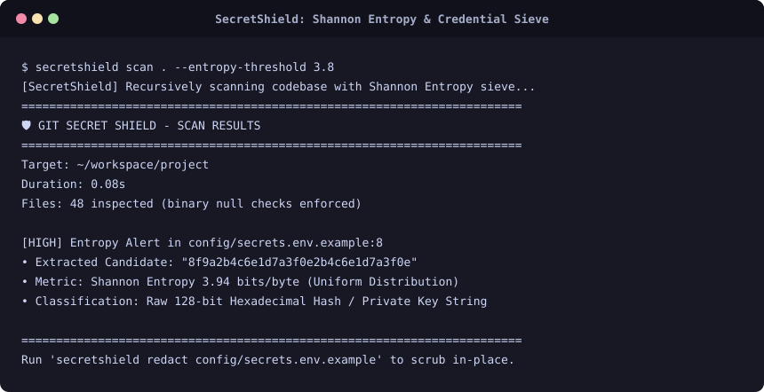

# git-secret-shield

A small, standard-library Python tool that looks for credential-shaped strings in files and in staged git changes, with a pre-commit hook and a redactor.

**Status: experimental.** It uses regular-expression signatures plus a Shannon-entropy heuristic. It can miss secrets and it can flag harmless data. A clean result is not proof that a repository has no credentials. No third party has audited it. Tests are the author's own, written with AI coding agents.

## Why it exists

Leaked keys usually get committed by accident. This project explores how far a dependency-free, offline checker gets: no network calls, no installs, nothing leaves your machine. It is a learning-grade guard rail, not a replacement for a mature scanner or for rotating credentials that were exposed.

## Visual Walkthrough & Execution Previews

### 1. Pre-Commit Staged Credential Gate


### 2. Shannon Entropy & High-Value Token Sieve


## Quick start

Requires Python 3.9 or newer (tested on 3.9 and 3.13). Run it from the repository root, no install needed:

```sh
python3 -m secretshield --help
python3 -m secretshield scan .
python3 -m secretshield scan --staged --fail-on-findings
python3 -m secretshield patterns
```

Real output from a scan of a folder holding one fake AWS-shaped key, run on 2026-11-21 with Python 3.13 (path shortened, `NO_COLOR=1`):

```text
[SecretShield] Recursively scanning directory: <dir>...
========================================================================
🛡️  GIT SECRET SHIELD - SCAN RESULTS
========================================================================
Target:   <dir>
Duration: 0.001s
Findings: 1
------------------------------------------------------------------------

1. [CRITICAL] AWS Access Key ID
   Location:  <dir>/config.py:1
   Preview:   AKIA************CDEF
   Guidance:  Revoke key in AWS IAM Console immediately. Check AWS CloudTrail for unauthorized API calls.

========================================================================
🚨 ALERT: Found 1 potential secret(s)!
Do not commit these secrets to remote repositories.
========================================================================
```

With `--fail-on-findings` that scan exits with status 1 (observed). Previews are masked; the full secret is never printed or written to JSON/Markdown reports.

## Usage

| Command | What it does |
|---|---|
| `scan [target]` | Scan a file or directory (default `.`). |
| `scan --staged` | Scan only lines added in the git index (`git diff --cached`). |
| `scan --json` / `--markdown` / `-o FILE` | Machine-readable or Markdown report, optionally written to a file. Reports contain paths and masked previews: review before sharing. |
| `scan --no-entropy` | Signatures only; skip the entropy heuristic. |
| `scan --fail-on-findings` | Exit 1 if anything is found (use in CI or hooks). |
| `install-hook` / `uninstall-hook` | Install or remove a git `pre-commit` hook that runs `scan --staged --fail-on-findings`. `install-hook --force` overwrites an existing hook. |
| `redact FILE [-o OUT] [-i] [--no-backup]` | Replace detected secrets with placeholders. `--in-place` edits the file (a `.bak` is kept unless `--no-backup`). Try it on a copy first. |
| `patterns` | List the built-in signatures (39 at this commit). |

Exit codes: 0 clean (or findings without `--fail-on-findings`), 1 findings with `--fail-on-findings`, 2 bad path.

The installed hook runs `python3 -m secretshield`, so the package must be importable by that `python3` (for example `pip install .`, or `PYTHONPATH` set). If `python3` is missing the hook prints a warning and lets the commit through. Anyone can skip a hook with `git commit --no-verify`.

If a real credential was exposed, revoke or rotate it with the issuing service. Removing it from a file does not remove it from git history.

## Configuration

There is no config file. The scanner is configured in code (`SecretScanner(...)`) and by CLI flags.

| Setting | Where | Default |
|---|---|---|
| Entropy checks on/off | `--no-entropy` / `check_entropy` | on |
| Minimum token length for entropy | `entropy_min_length` | 20 |
| Entropy thresholds (bits/char) | `is_high_entropy(...)` in `entropy.py` | hex 3.2, base64 4.6, other 4.3 |
| Skipped folders | `DEFAULT_IGNORED_DIRS` (`.git`, `node_modules`, `venv`, `env`, `dist`, `build`, ...) | only folders below the scan root count |
| Skipped extensions / lockfiles | `DEFAULT_IGNORED_EXTENSIONS`, `DEFAULT_IGNORED_FILENAMES` | images, archives, binaries, common lockfiles |
| Color | `NO_COLOR` environment variable | color only on a TTY |

## How it works

```text
secretshield/
  cli.py       argparse dispatcher, report printing, exit codes
  scanner.py   file/dir/staged-diff traversal; phase 1 regex signatures, phase 2 entropy
  patterns.py  the signature catalog (name, regex, severity, remediation text)
  entropy.py   Shannon entropy, token extraction, false-positive allowlist
  redactor.py  placeholder substitution for detected secrets
  hook.py      installs/removes the pre-commit hook
  report.py    JSON and Markdown reports (masked previews only)
```

Each line is checked against every signature. Remaining long tokens that look random (high Shannon entropy for their character set, not a UUID, not on a benign-substring list) are reported as entropy candidates. Binary files (NUL bytes), media, archives and lockfiles are skipped.

## Security notes and limits

- **It can miss secrets.** Split, encoded, encrypted, short or unusual-format credentials are not found. Files over the skip rules (binary, lockfiles, ignored folders) are never read.
- **It can flag harmless data.** Entropy checks produce false positives (hashes, ids, test fixtures).
- **Not a security boundary.** A hook is advisory; it can be bypassed or removed.
- **Reports are sensitive.** They list file paths and masked previews of what looked like secrets.
- The source defines its own signatures and test values from string pieces so that this repository does not itself trip secret scanners.
- Found a vulnerability? Use GitHub's private vulnerability reporting (Security tab). See [SECURITY.md](SECURITY.md).

## Tests

```sh
python3 -m unittest discover -s tests
```

Observed 2026-11-21 on macOS with a scratch `HOME` and `TMPDIR`, no installs: Python 3.9.6 `Ran 32 tests ... OK`; Python 3.13.17 `Ran 32 tests ... OK`. CI (`.github/workflows/ci.yml`) runs the same on Ubuntu 24.04 and macOS with Python 3.9 and 3.13.

## Engineering Standards & Magi Bible 📖

All code, documentation, and operational protocols follow the open-source **Magi AI Engineering Standard**:
- **[MAGI_LOOK_HERE.md](MAGI_LOOK_HERE.md):** Contributor & autonomous agent operational rules, code of conduct, and verification criteria.
- **[MAGI_BIBLE.md](MAGI_BIBLE.md):** The Universal Magi Bible establishing Rule 16 commentary ($\ge 25\%$), visual walkthrough previews, fail-closed boundaries, and standard library reliance.

## Contributing

See [CONTRIBUTING.md](CONTRIBUTING.md) and the [Code of Conduct](CODE_OF_CONDUCT.md). Questions and bugs: [GitHub Issues](https://github.com/Ethan-da-Tech-Wizard/git-secret-shield/issues).

## License

[MIT](LICENSE), copyright Ethan-da-Tech-Wizard.
